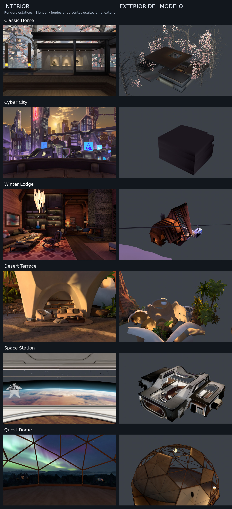
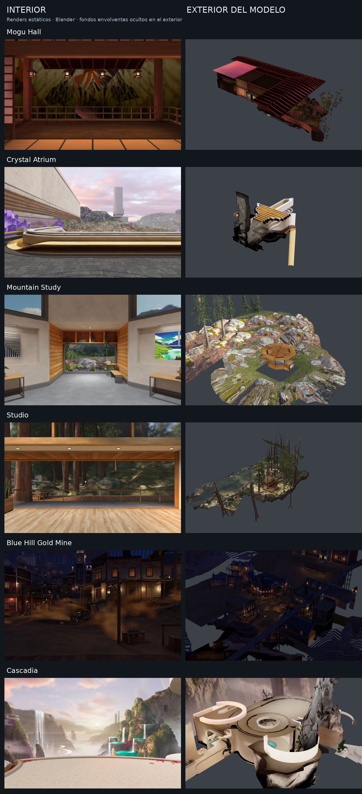
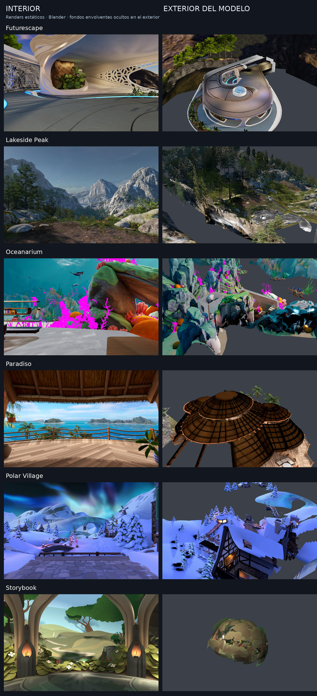
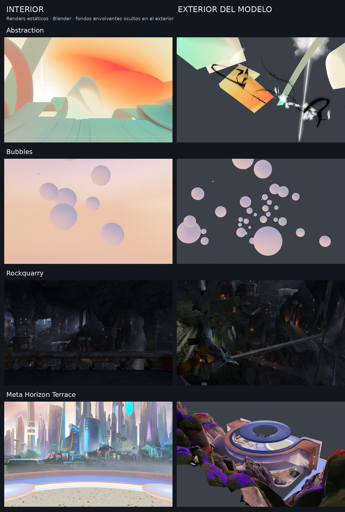

# Meta Quest Homes — 22 Environments for 3D Exploration

A documented collection of **22 Home environments attributed to Meta/Oculus**, extracted as static **glTF 2.0 / GLB** scenes, with source scene archives, technical metrics, and rendered interior and exterior views.

Designed for inspection in 3D tools, spatial composition analysis, and comparison of virtual reality environments.

> **Independent project, not affiliated with Meta.** This collection covers the 22 entries in the **Root** catalog of Quest Home Switcher, release `homes-v2.0.0`. The packages used are community-adapted ports of content attributed to Meta/Oculus by that catalog. They have not been verified as historical original APK builds, and this collection is not an exhaustive list of every Home ever released by Meta.

## Gallery

**Left: interior. Right: model exterior.** These are static Blender renders of the extracted scenes, not headset screenshots. Enclosing backgrounds and selected background elements were hidden in the exterior previews to reveal the main geometry.

The original contact sheets are preserved below. Their Spanish labels mean **Interior**, **Model exterior**, and **Static renders · Blender · enclosing backgrounds hidden in exterior views**.

### Classic Home · Cyber City · Winter Lodge · Desert Terrace · Space Station · Quest Dome

### Mogu Hall · Crystal Atrium · Mountain Study · Studio · Blue Hill Gold Mine · Cascadia

### Futurescape · Lakeside Peak · Oceanarium · Paradiso · Polar Village · Storybook

### Abstraction · Bubbles · Rockquarry · Meta Horizon Terrace

Camera placements are approximate inspection viewpoints. Materials, lighting, and effects may differ from the original experience. Preview renders used copies with textures limited to a maximum dimension of 512 pixels; this preview reduction does not modify the distributed GLB files. Some exterior faces were never intended to be viewed from outside the environment.

## Contents and organization

This documentation package includes the README, four rendered contact sheets, and the catalog in CSV and JSON formats. **Models and source scenes are separate downloads**; their binaries are not included in this documentation package.

| Suggested path | Contents |
|---|---|
| `README.md` | Overview, gallery, and instructions |
| `docs/images/` | Four contact sheets containing 44 views |
| `catalog/catalog_and_metrics.csv` | Metrics table for analysis |
| `catalog/catalog_and_metrics.json` | Metrics, hashes, and extraction reports |
| `models/<id>.glb` | Individual static model, added separately |
| `sources/<id>_source_scene.zip` | Individual source scene archive, added separately |

The `<id>` values are listed below. The repository can host documentation and link to binaries from its downloads section. Add distribution links once the files are published; this README does not assume those binaries are already available in the repository.

## Environments and metrics

The recorded export contains **9,249,150 triangles** and **5,689,359 vertices**. Counts refer to exported geometry instances; they are not measurements of draw calls or headset performance. File sizes below use decimal megabytes.

| Home | Identifier | Triangles | GLB (MB) |
|---|---|---:|---:|
| Abstraction | `abstraction` | 100,552 | 36.5 |
| Blue Hill Gold Mine | `blue-hill-gold-mine` | 675,264 | 344.1 |
| Bubbles | `bubbles` | 55,776 | 3.6 |
| Cascadia | `cascadia` | 355,529 | 229.4 |
| Classic Home | `classic-home` | 104,942 | 105.0 |
| Crystal Atrium | `crystal-atrium` | 312,029 | 264.3 |
| Cyber City | `cyber-city` | 584,044 | 145.1 |
| Desert Terrace | `desert-terrace` | 388,700 | 137.9 |
| Futurescape | `futurescape` | 542,405 | 180.6 |
| Lakeside Peak | `lakeside-peak` | 454,241 | 878.9 |
| Meta Horizon Terrace | `meta-horizon-terrace` | 520,347 | 500.7 |
| Mogu Hall | `mogu-hall` | 210,479 | 131.6 |
| Mountain Study | `mountain-study` | 225,018 | 251.8 |
| Oceanarium | `oceanarium` | 1,643,555 | 123.7 |
| Paradiso | `paradiso` | 175,246 | 151.3 |
| Polar Village | `polar-village` | 549,111 | 204.0 |
| Quest Dome | `quest-dome` | 251,308 | 58.3 |
| Rockquarry | `rockquarry` | 138,090 | 170.1 |
| Space Station | `space-station` | 376,181 | 79.7 |
| Storybook | `storybook` | 850,670 | 75.5 |
| Studio | `studio` | 420,067 | 241.9 |
| Winter Lodge | `winter-lodge` | 315,596 | 110.4 |

See the [CSV catalog](catalog/catalog_and_metrics.csv) or [JSON catalog](catalog/catalog_and_metrics.json) for SHA-256 hashes, package names, spatial bounds, and load reports.

## Opening a model

### Blender

1. Download the `<id>.glb` file for the environment you want to explore.
2. Import it using **File → Import → glTF 2.0**.
3. Inspect the scene objects and materials. If the framing appears excessively large, select the main geometry: some environments contain skyboxes or distant auxiliary vertices.

The GLB files embed the textures used by the export. A Quest headset and root access are not required to open them.

### Unity

Use an importer compatible with glTF 2.0 and the materials/extensions present in the file. After importing, review transparency, unlit materials, and face orientation.

The export does not automatically create colliders, navigation, interactions, or working animations. These components must be reconstructed in the project.

### Source scenes

Each `<id>_source_scene.zip` preserves the internal scene extracted from its package. **It is not a ready-to-open Blender or Unity project.** It provides the source resources for inspection and further conversion work.

The complete extraction bundles may also contain `apk_assets`, properties, and auxiliary metadata. Do not assume those additional resources are included in an individual source scene ZIP.

## Preserved by the export

- Geometry placement with world transforms baked into the export.
- UV0/UV1 coordinates, vertex colors, and the PNG textures used by the model.
- Tints, transparency modes, and double-sided flags where interpreted by the extractor.
- Package and scene traceability through catalog hashes and reports.

## Known limitations

- **Static scenes:** animations are not converted into playable glTF tracks. Animation resources, skeletons, vertex animation textures (VAT), and other data remain in the source files where present.
- **Approximate materials:** original shaders and lighting are not reproduced exactly. Standard glTF materials do not faithfully reproduce the original additive blending behavior.
- **Packed maps:** certain normal/ORM textures require interpretation specific to the original shader.
- **Lightmaps:** PNG files derived from HDR lightmaps include exposure and tone mapping; they do not represent raw HDR radiance.
- **Normals:** reconstruction depends on the importing application.
- **Oceanarium and Storybook:** decoded textures in these static exports were limited to a maximum dimension of 1024 pixels using nearest-neighbor resampling to fit available memory. Their original compressed textures remain in the source scenes.
- **Skipped elements:** load reports identify components classified as UI/gizmos and other undecoded elements. A successful export does not imply complete recovery of the environment's logic.
- **Historical comparisons:** dates and versions of these adapted packages must not be treated as release dates for the original designs.

## Validation and research use

During extraction, APK and internal scene SHA-256 hashes were checked against the catalog. Image references, buffer/accessor bounds, triangle indices, and GLB lengths were also checked. The combined archive of all 22 models was subsequently recovered with the same SHA-256 and passed CRC verification of its entries.

These checks assess file integrity and structural consistency. **They do not establish visual or functional equivalence with native execution on Quest.**

For reproducible analysis, record the Home identifier, GLB hash, importer version, and any subsequent modifications. Distinguish design observations from conversion artifacts. Catalog bounds include backgrounds and auxiliary geometry; they are not equivalent to walkable area or room dimensions.

## Technical provenance

- Source catalog: [Quest Home Switcher — homes-v2.0.0](https://github.com/nikitat21/Quest-Home-Switcher/releases/tag/homes-v2.0.0), Root collection.
- Reference code: [Quest Home Switcher](https://github.com/nikitat21/Quest-Home-Switcher), commit `6e6e74dc3a55faa1d0eb3815b994ece5f9982815`.
- Reference extractor: [Quest Home Editor](https://github.com/nikitat21/Quest-Home-Editor), commit `fd95db7415fbf63032961db8df07dc5f01207831`.
- ASTC decoding: [ARM astc-encoder](https://github.com/ARM-software/astc-encoder), tag `4.8.0`.
- Documented extraction snapshot: **October 4, 2026**.

The extraction used fixes for numeric JSON references represented as strings, deferred texture loading, and transform baking before export. The separate toolkit package contains the scripts, extractor patch, and reproduction instructions.

## Attribution and rights

Third-party names, designs, models, textures, and other resources retain their respective rights holders and terms. Inclusion in this catalog does not grant a license to the assets or attribute their authorship to the repository maintainer. No blanket open-source license is declared for the collection.

Retain the attribution and licenses of the upstream tools. This documentation distinguishes extraction and analysis work from the design of the environments attributed to Meta/Oculus.
